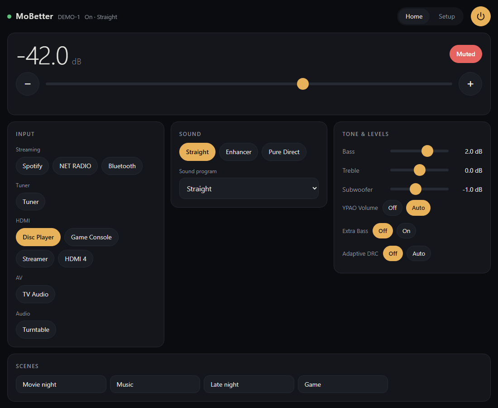
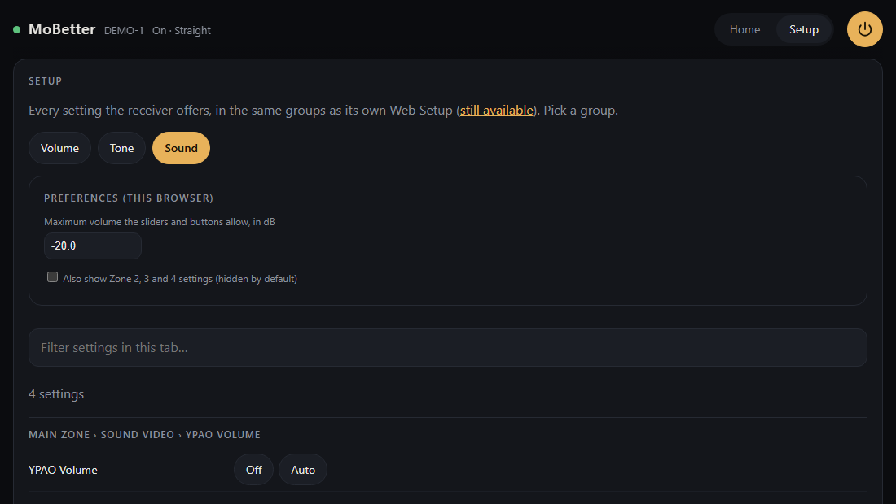

# MoBetter

**A local-first control panel for home audio: one page in any browser runs the receiver, TV box, phono preamp and lights. No cloud, no app.**

A modern, dark, minimal web page for controlling a Yamaha AV receiver from your phone, tablet or PC. It does everything the receiver's own Web Setup page does (every setting, in the same groups) and adds a clean Home screen.

> **Status: early. Built and tested on an RX-A3070; also running on a TSR-5830 (the RX-V583's twin), where the Home page and the settings list load and show live status.** Other Yamaha models should work, because the page builds itself from your own receiver's list of settings, but that is not proven yet. If you try it, a *Compatibility report* (Issues tab) is the most useful thing you can send.
> **Not affiliated with Yamaha.** "Yamaha" is a trademark of its owner, used here only to say which products this works with. **Use at your own risk:** the Setup screens can change things like speaker settings, and even factory-reset a receiver. Anything risky asks you to confirm first.





## What you get
- **Home:** power, volume (with a maximum you set), mute, every input with your own names, sound programs, Straight / Enhancer / Pure Direct, bass, treble, subwoofer, scenes.
- **Rename inputs:** tap **Rename** on the Input card, then tap an input. The receiver keeps the new name (front display, Yamaha's app, and here). Up to 14 plain characters.
- **Google TV remote (optional):** start once with `--gtv <box address>` (remembered). A card mirroring the onn remote appears: power, arrows/OK, back, home, live TV, Free TV, channel, apps (YouTube, Netflix, Disney+, Paramount+); volume and mute go to the receiver. First time: tap **Pair**, type the 6-digit code the TV shows. Local network only (library: `pip install androidtvremote2`); the pairing key stays in `data/`.
- **Google TV screen view (optional):** **Show screen** in the Google TV card shows what the TV is displaying (a screenshot every few seconds). It uses Android's own Wireless debugging: on the box, Settings > System > Developer options > Wireless debugging (on), then **Pair screen** and type the port and code the TV shows. Needs Android's `adb` tool (Platform Tools) on the computer running MoBetter. Streaming apps show black here; they still play on the TV. Android turns Wireless debugging off after the box restarts, so switch it on again after a restart (no new pairing needed).
- **Listen card (your own one-tap scenes):** buttons like "TV", "Records" or "Music · DAC" that turn the receiver on, pick the input and set Pure Direct or Straight in one tap. Copy `scenes.example.json` to `scenes.json` and edit it for your rack (see the example file for the fields).
- **Parks Audio Waxwing phono preamp (optional):** a Waxwing card with output (analog / digital 24/48 / 24/96), gain with MM and MC presets, load, mode, EQ curve, Magic, DeRumble, tone, filters, balance, volume and a cue mute, plus live levels. See [Waxwing](#parks-audio-waxwing-optional) below.
- **More than one receiver:** run one copy of MoBetter per receiver, each in its own folder with its own `--port`, and add `"peers": [{"name": "Office", "port": 8781}]` to each `config.json`. Every page then shows a small button that jumps to the others.
- **AiDot / Linkind Wi-Fi bulbs (optional):** a lights card with scene buttons, colors, brightness and warmth per group, all local after a one-time sign-in that fetches each bulb's key (`pip install python-aidot`; config `"aidot": {"devices_file": ..., "groups": [...]}`, see `aidot_lights.py`).
- **Arrange the boxes:** drag any box by its title to move it. The order is remembered in that browser. Wide screens get four columns.
- **Setup:** every group of the receiver's own settings, with the right control for each (choices, number ranges, text), live values, and a filter box.
- **Phone friendly,** installable to your home screen.
- **Private:** nothing leaves your home network. No accounts, no telemetry.

## Install (needs Python 3.9 or newer; nothing else to install)
You need three things: **Python** (get it from python.org; on Windows tick "Add python.exe to PATH"), **this project**, and **your receiver's address**.

1. **Find your receiver's address.** In the receiver's on-screen Setup menu look under Network (Network Information), or look it up in your router's device list. It looks like `192.168.0.50`. Tip: give the receiver a fixed address in your router so it never changes.
2. **Download this project** (green *Code* button, then *Download ZIP*) and unzip it somewhere.
3. **Start it.** Open a terminal (on Windows: Start, type `cmd`) in that folder and run, using your own address:
   ```
   python server.py --receiver 192.168.0.50
   ```
   The address is remembered. Next time, just run `python server.py` (or double-click `start.bat` on Windows, `start.sh` on Mac/Linux).
4. **Open the page:** `http://localhost:8780` on the same computer.
5. **Phone or tablet:** add `--lan` (`python server.py --lan`), then open `http://<this computer's address>:8780` on a device on your home Wi-Fi, and use *Add to Home Screen*. Windows may ask to allow Python through the firewall: choose *Private networks* only.

The first start downloads the settings list from your own receiver and saves it in the local `data/` folder. It takes a few seconds. Nothing from Yamaha is included in this project.

**Want to look around first?** `python tools/demo_receiver.py` starts a pretend receiver. In another window run `python server.py --receiver 127.0.0.1:8790` and open the page. Nothing real is touched.

If the page says the receiver is not reachable, check the address and that *Network Standby* is on (receiver Setup > Network).

## Safety, please read
- **Receivers have no password.** Anyone on your Wi-Fi (guests too) can use this page, just as they could use the receiver's own pages. **Never expose it to the internet.** Do not forward a port to it.
- Only private-network devices are served, only the receiver's own control paths are forwarded, and every change is written to `data/audit.log`.
- The volume maximum starts at -20 dB. Raise it in **Setup > Preferences**.
- `python tools/backup_settings.py` saves a read-only backup of your receiver's settings to `data/` first. It is a good habit before you change settings.

## Parks Audio Waxwing (optional)
The [Waxwing](https://www.parksaudiollc.com/) is a phono preamp with a published Bluetooth LE API
([API](https://www.parksaudiollc.com/bluetoothapi.html), [manual](https://www.parksaudiollc.com/waxwingmanual.html)). MoBetter can show a
full Waxwing card. There are two ways to connect, set in `config.json`:

1. **Bridge on a small Linux box near the Waxwing (recommended, the way the author runs it).** Copy `pi-waxbridge/` to a Raspberry Pi
   (or any Linux machine with Bluetooth LE and Python 3.10+ with `bleak`) within Bluetooth range of the Waxwing, run
   `pi-waxbridge/start.sh`, then add `"waxwing_bridge": "http://<pi address>:8790"` to MoBetter's `config.json`. The bridge keeps one
   connection open while MoBetter is in use and lets go about a minute after you close the page, so the Waxwing phone app can connect
   again. Changes land in about a second. On piCorePlayer: install Bluetooth from its Bluetooth page, turn on the Pi's built-in
   Bluetooth, and start the bridge from Tweaks > User commands (`/home/tc/waxbridge/start.sh`), then run `pcp bu` to keep it.
2. **Direct, from the computer running MoBetter:** `pip install bleak`, then add `"waxwing": true` to `config.json`. Fine if that computer
   is close to the Waxwing and its Bluetooth is solid. On Windows, run MoBetter as a normal user account: the system account cannot use
   Bluetooth LE.

Things learned the hard way (thanks to Shannon Parks at Parks Audio):
- **After subscribing to the status stream, wait before the first command:** about 1.1 s on Windows/Mac, about 2.2 s on Linux.
  Without the pause the Waxwing hits an internal timeout and drops the link after ~5 seconds. There is no keep-alive; once the
  stream is on, the connection stays up.
- **Subscribe once and space commands about 500 ms apart.** Don't flood it.
- **There is no save command, on purpose** (it protects the flash memory). The Waxwing checks its settings every 10 minutes and
  writes them to flash only if something changed, so a change sticks within 10 minutes; a power cut sooner can lose it. The
  "flash saves" byte (92) holds random data after power-up, not a real count; the reset button clears it.
- The Waxwing takes **one Bluetooth connection at a time**: close its phone app while MoBetter is connected.
- `tools/waxwing_probe.py` is a read-only check that finds the Waxwing and reads one status packet.

## Adding your own devices
MoBetter controls a Yamaha receiver, plus a Google TV box and a Waxwing if you have them. Your rack is different, and the page is
built to be extended. Fork it and follow the same pattern the two add-ons use:

1. **A device module next to `server.py`** (see `gtv.py` and `waxwing.py`): one small class that knows how to read the device's status
   and send it commands. Keep the device's library optional: if it is not installed, the card simply does not appear.
2. **A narrow API in `server.py`:** one `GET /api/<device>/status` and one `POST /api/<device>/...` for commands. **Allow-list every
   command** (only the functions and value ranges you need), require the page's `X-RX-UI: 1` header on writes, and write each change to
   `data/audit.log`, like the existing Google TV and Waxwing handlers.
3. **A card in `web/index.html` plus a little code in `web/app.js`:** a `<section class="card hidden" id="...card">` that the page reveals
   when the status call says the device is configured. Reuse the existing building blocks (`chip`, the `srow` slider rows, `toast`).
   Every card can be dragged like the others.
4. **A switch in `config.json`** (for example `"mydevice": "192.168.0.60"`), read in `main()` in `server.py`. Never put passwords or
   tokens in the code; keep pairing keys in `data/`, which is never published.
5. **Scenes:** a device that needs a setting per scene can get its own optional field in `scenes.json` (see how `waxwing_output` is
   handled in `runScene` in `web/app.js`).

How to reach different kinds of gear:
- **Network devices with an HTTP or JSON API** (many streamers, receivers, smart plugs such as Shelly): the easiest kind. Call them
  from the server (`urllib.request`), never straight from the browser.
- **Android TV / Google TV boxes:** the Android TV Remote protocol (`androidtvremote2`), as `gtv.py` does.
- **Bluetooth LE devices:** `bleak` works on Windows, macOS and Linux. If the computer running MoBetter is far from the device, or its
  Bluetooth is unreliable, run a tiny bridge on a Raspberry Pi near it (copy `pi-waxbridge/` as a starting point). Read the maker's
  notes on timing: many devices need a pause after connecting.
- **Infrared-only gear** (most DACs, CD transports, older TVs): a Wi-Fi IR blaster such as a BroadLink RM4 Mini, driven locally with
  `python-broadlink`. Learn the codes from the original remote; keep the blaster off the maker's cloud so local control keeps working.
- **HDMI-CEC:** turn on HDMI Control on the receiver (Setup > HDMI). Sources can then wake the TV and the receiver together.
- **Something you just switch on and off:** a smart plug or relay with a local API (for example Shelly).

Keep the rules that make MoBetter safe: home network only, allow-listed commands, an audit log, nothing risky without a confirmation,
and no secrets in the code.

## Tell me whether it works on your receiver
This is the most useful thing you can do. Run (read-only, about a minute):
```
python tools/diagnose.py
```
It writes a short report (model, firmware, which features it found, how many settings could be read) to `data/diagnose-report.md`. It does not include your address, MAC, serial number, device name or Wi-Fi name. Read it, then paste it into a *Compatibility report* on the Issues tab.

## More than one receiver
Each copy of MoBetter talks to one receiver. For a second receiver (another room), run a second copy next to the first:

1. Copy the MoBetter folder to a new folder (for example `MoBetter-Office`). Leave out `data/`, `config.json` and `scenes.json`; the new copy makes its own.
2. Start it with the second receiver's address and its own port: `python server.py --receiver 192.168.0.60 --port 8781 --lan`. Keep using `--port 8781` every time you start that copy (the port is never saved).
3. Add a `"peers"` list to **each** copy's `config.json` so the pages link to each other, for example in the first copy:
   `"peers": [{"name": "Office", "port": 8781}]` and in the second: `"peers": [{"name": "Main", "port": 8780}]`.
   A small **Office ↗** / **Main ↗** button appears in the top bar. With `"port"` the link keeps whatever address you opened the page with (IP or computer name), so it works from phones too. A full address also works: `{"name": "Office", "url": "http://192.168.0.50:8781/"}`.
4. Optional extras (Google TV, Waxwing, lights, HDMI watchdog) are per copy; leave them out of the second `config.json` unless that room has them.

Tip: give each receiver a fixed address in your router, so a power cut never breaks the link.

## Tests
`python -m unittest discover -s tests` (uses a tiny fake receiver; no hardware needed).

## About this project
MoBetter is a personal project, shared as-is under the [MIT license](LICENSE). It is **read-only**: pull requests and feature requests are not accepted (see [CONTRIBUTING](CONTRIBUTING.md)). You are free to fork it.

## Optional: GlitterVis card

If you run the GlitterVis music visualizer on the same PC, add `"glittervis": true` to `config.json` and MoBetter shows a
GlitterVis card: start and stop, previous and next scene, jump to a scene, lock, calm, and full screen or a small, medium or large window.
MoBetter talks to GlitterVis on `127.0.0.1:8795` (same PC only). The Start button runs a Windows scheduled task named
**GlitterVis** that opens it on the signed-in desktop, because MoBetter itself usually runs in a background session that cannot show windows.
Without the setting the card stays hidden.

## Optional: HDMI audio watchdog (Windows)

If MoBetter runs on a PC that feeds the receiver over HDMI, add `"hdmi_watch": {"input": "av4", "bounce_input": "av1"}` (your PC's input,
and any other input) to `config.json`. When the PC is playing sound but the receiver shows no audio signal on that input for about 8 seconds,
MoBetter switches to the other input and back, which makes the receiver pick the HDMI audio up again. Each fix goes in `data/audit.log`;
it backs off after 3 tries in 10 minutes. `GET /api/hdmiwatch` shows what it sees.

**Tip (Yamaha):** set the PC's input to *Audio Select: HDMI* rather than *Auto*. With Auto, a dropped HDMI link (a reboot, or a
display mode change) can leave the receiver listening to that input's empty analog jack.
