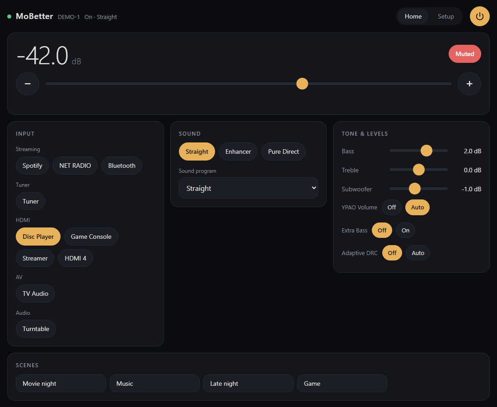
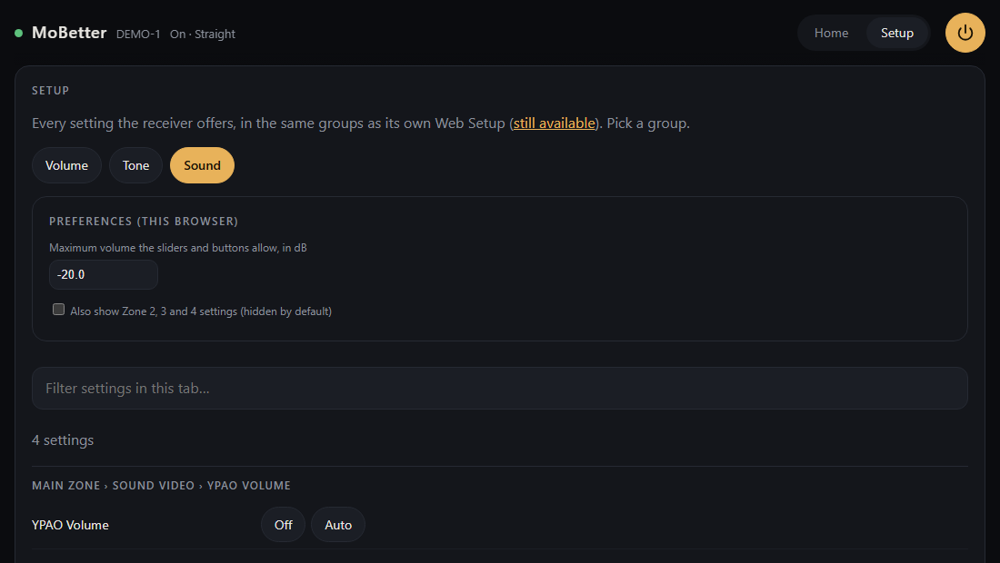

# MoBetter

A modern, dark, minimal web page for controlling a Yamaha AV receiver from your phone, tablet or PC. It does everything the receiver's own Web Setup page does (every setting, in the same groups) and adds a clean Home screen.

> **Status: early. Built and tested on one receiver (RX-A3070).** Other Yamaha models should work, because the page builds itself from your own receiver's list of settings, but that is not proven yet. If you try it, a *Compatibility report* (Issues tab) is the most useful thing you can send.
> **Not affiliated with Yamaha.** "Yamaha" is a trademark of its owner, used here only to say which products this works with. **Use at your own risk:** the Setup screens can change things like speaker settings, and even factory-reset a receiver. Anything risky asks you to confirm first.





## What you get
- **Home:** power, volume (with a maximum you set), mute, every input with your own names, sound programs, Straight / Enhancer / Pure Direct, bass, treble, subwoofer, scenes.
- **Setup:** every group of the receiver's own settings, with the right control for each (choices, number ranges, text), live values, and a filter box.
- **Phone friendly,** installable to your home screen.
- **Private:** nothing leaves your home network. No accounts, no telemetry.

## Install (needs Python 3.9 or newer; nothing else to install)
You need three things: **Python** (get it from python.org; on Windows tick "Add python.exe to PATH"), **this project**, and **your receiver's address**.

1. **Find your receiver's address.** In the receiver's on-screen Setup menu look under Network (Network Information), or look it up in your router's device list. It looks like `192.168.0.50`. Tip: give the receiver a fixed address in your router so it never changes.
2. **Download this project** (green *Code* button, then *Download ZIP*) and unzip it somewhere.
3. **Start it.** Open a terminal (on Windows: Start, type `cmd`) in that folder and run, using your own address:
   ```
   python server.py --receiver 192.168.0.50
   ```
   The address is remembered. Next time, just run `python server.py` (or double-click `start.bat` on Windows, `start.sh` on Mac/Linux).
4. **Open the page:** `http://localhost:8780` on the same computer.
5. **Phone or tablet:** add `--lan` (`python server.py --lan`), then open `http://<this computer's address>:8780` on a device on your home Wi-Fi, and use *Add to Home Screen*. Windows may ask to allow Python through the firewall: choose *Private networks* only.

The first start downloads the settings list from your own receiver and saves it in the local `data/` folder. It takes a few seconds. Nothing from Yamaha is included in this project.

**Want to look around first?** `python tools/demo_receiver.py` starts a pretend receiver. In another window run `python server.py --receiver 127.0.0.1:8790` and open the page. Nothing real is touched.

If the page says the receiver is not reachable, check the address and that *Network Standby* is on (receiver Setup > Network).

## Safety, please read
- **Receivers have no password.** Anyone on your Wi-Fi (guests too) can use this page, just as they could use the receiver's own pages. **Never expose it to the internet.** Do not forward a port to it.
- Only private-network devices are served, only the receiver's own control paths are forwarded, and every change is written to `data/audit.log`.
- The volume maximum starts at -20 dB. Raise it in **Setup > Preferences**.
- `python tools/backup_settings.py` saves a read-only backup of your receiver's settings to `data/` first. It is a good habit before you change settings.

## Tell me whether it works on your receiver
This is the most useful thing you can do. Run (read-only, about a minute):
```
python tools/diagnose.py
```
It writes a short report (model, firmware, which features it found, how many settings could be read) to `data/diagnose-report.md`. It does not include your address, MAC, serial number, device name or Wi-Fi name. Read it, then paste it into a *Compatibility report* on the Issues tab.

## Tests
`python -m unittest discover -s tests` (uses a tiny fake receiver; no hardware needed).

## About this project
MoBetter is a personal project, shared as-is under the [MIT license](LICENSE). It is **read-only**: pull requests and feature requests are not accepted (see [CONTRIBUTING](CONTRIBUTING.md)). You are free to fork it.
